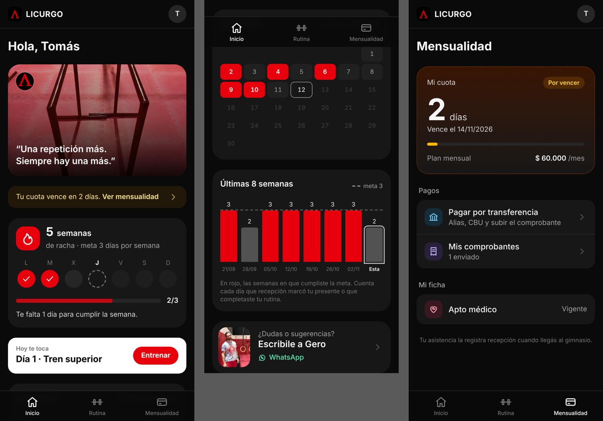
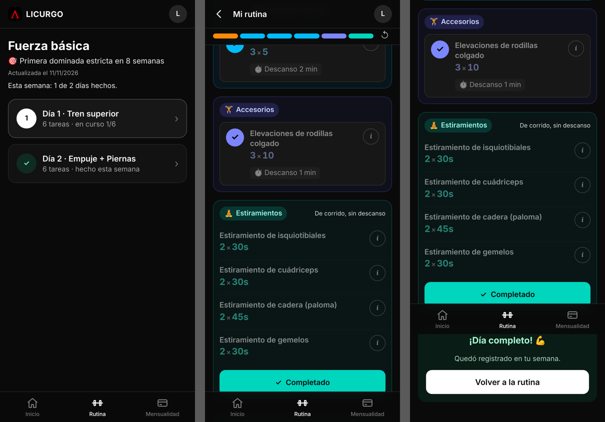

# App del alumno: Inicio, Rutina y Mensualidad

**Pareja B** · rama `feature/b1-inicio-racha` → `dev`

Tres pestañas abajo, como una app de celular:

| Pestaña | Ruta | Qué tiene |
|---|---|---|
| **Inicio** | `/alumno` | Foto de Licurgo con la frase del día, racha, "Hoy te toca", calendario del mes, últimas 8 semanas y contacto con Gero |
| **Rutina** | `/alumno/rutina` | La lista de días; cada día se abre en su propia pantalla con el checklist |
| **Mensualidad** | `/alumno/mensualidad` | Estado de la cuota, pagar por transferencia, mis comprobantes, apto médico (B4) |

## Inicio: motivación para entrenar

- **Foto y frase:** 14 fotos del gimnasio del productor audiovisual (`public/img/gimnasio/`). Siempre arranca con el logo grande de la pared; cada foto trae su frase (`frasePara` en `lib/racha.js`) y pasan juntas cada 6 s (quietas si el celular pide menos movimiento). Las frases se corren un lugar por día.
- **Qué cuenta como día entrenado:** el presente que marca recepción (`asistencias`) **o** completar un día de la rutina en la app (`dias_completados`). Un mismo día cuenta una vez.
- **Meta semanal:** la cantidad de días de la rutina del alumno (si no tiene rutina, 3).
- **Racha:** semanas seguidas cumpliendo la meta. Se cuenta por semanas y no por días porque en calistenia se descansa: una racha diaria se cortaría en cada día de descanso. La semana en curso suma cuando se cumple y, mientras tanto, no corta la racha.
- **Esta semana:** L a D con tilde rojo en los días entrenados, barra `entrenados/meta` y un mensaje ("Te falta 1 día para cumplir la semana", "¡Semana cumplida! Llevás 5 semanas seguidas").
- **Hoy te toca:** el día de la rutina que corresponde (misma regla que la pantalla de rutina) con botón **Entrenar**.
- **Mes:** calendario con los días entrenados y el total.
- **Últimas 8 semanas:** días entrenados por semana con la meta punteada; en rojo las semanas cumplidas.
- **Cuota:** si vence en 3 días o venció, un aviso lleva a Mensualidad.
- **Contacto:** foto de Gero, "Escribile a Gero" → WhatsApp (número de *Datos de cobro*, hoy 381 624-5748).

## Rutina: lista de días y pantalla del día

- **`/alumno/rutina`**: los días de la rutina uno debajo del otro, con cuántas tareas tienen y su estado: *hoy te toca* (con la etiqueta **Hoy**), *en curso 3/6* o *✓ hecho esta semana*. Sin checklist en esta pantalla, para no sobrecargarla.
- **`/alumno/rutina/dia/:numero`**: tocar un día abre su pantalla aparte (con "‹" para volver, igual que en Mensualidad). Tiene la barra de progreso fija arriba, las secciones con sus tildes y, al terminar, *"¡Día completo!"* con un botón para volver.
- **Finalizar entrenamiento:** si tildó algo pero se tiene que ir, el botón pide confirmar ("¿Finalizar con 3 de 6?") y el día queda registrado en la semana; la próxima vez sigue con el día siguiente.
- **No quedar trabado:** si un día quedó a medias y no se finalizó, al día siguiente igual se pasa al próximo día de la rutina (sin marcarlo como hecho).
- Abrir un día lo vuelve el día del checklist de hoy. El botón **Entrenar** del Inicio abre directamente el día que toca.

## Marca

Logo Λ de Licurgo (rojo sobre negro) en los íconos de la app, el encabezado y la foto del Inicio. El rojo de la marca es el color de la racha y de los días entrenados.

## Pruebas

- **Unitarias** (`lib/racha.js`): meta, unión de fuentes sin repetir, semanas lunes a domingo, racha (semana actual a medias no corta, sí suma cuando se cumple, se corta con una semana incompleta), semana en curso, calendario (mes que empieza en domingo, febrero), mensajes, frase estable en el día.
- **Navegador:** Inicio con historial de 8 semanas (racha 5, 2/3 esta semana), aviso de cuota, contacto; rutina: lista de días, pantalla del día con "‹" a la rutina, completar un día ("¡Día completo!" y ✓ en la lista), día a medias "en curso 1/6".

## Un día de rutina por fecha (12/11)

- Antes se podían completar varios días de la rutina el mismo día (ej.: Día 2, 3 y 4 el miércoles). Así *Rutina* mostraba 5 de 5 días hechos e *Inicio* mostraba 2 días entrenados: una pantalla contaba días de la rutina y la otra días del calendario.
- Ahora se cuenta **un día de la rutina por fecha** (índice único `uq_un_dia_por_fecha`, migración `20261112_04`). Cuando ya completó (o finalizó) un día, los demás se pueden mirar pero no tildar hasta mañana, y la lista avisa: *Hoy ya entrenaste: mañana seguís con el próximo*.
- Las dos pantallas quedan siempre de acuerdo: días de la rutina hechos en la semana = días entrenados en la semana.
