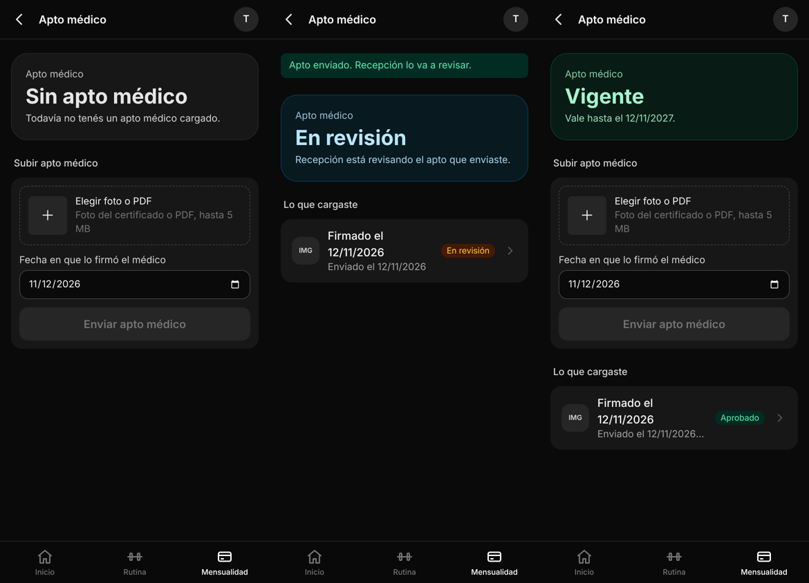
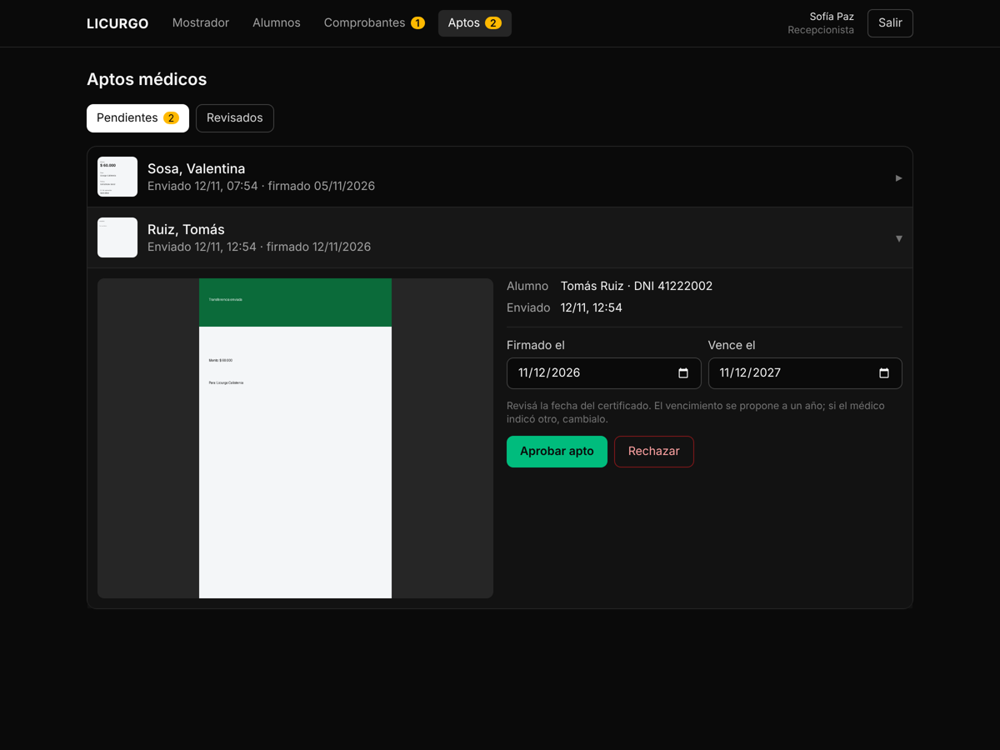

# B4 · Apto médico (carga del alumno y aprobación)

**Pareja B** · Complementa B4 (Mi membresía) y sigue el mismo circuito que los comprobantes de transferencia (B5).
Migración `supabase/migrations/20261112_03_b4_apto_medico.sql` (sección 19.15 de `schema.sql`).

## Funcionalidades

| Rol | Pantalla | Qué hace |
|-----|----------|----------|
| Alumno | Mensualidad → **Apto médico** (`/alumno/apto`) | Ve el estado: *Sin apto*, *En revisión*, *Vigente hasta…*, *Por vencer*, *Vencido* o el motivo del rechazo |
| Alumno | Subir apto médico | Foto o PDF (hasta 5 MB) + fecha en que lo firmó el médico. Queda **En revisión** |
| Alumno | Lo que cargaste | Historial; tocar abre el archivo |
| Recepción / SuperAdmin | Menú **Aptos** (contador amarillo) · `/recepcion/aptos` | Pendientes y revisados, con miniatura |
| Recepción / SuperAdmin | Detalle | Archivo grande, *Firmado el* y *Vence el* (por defecto a un año, editable) |
| Recepción / SuperAdmin | **Aprobar apto** / **Rechazar** | Al aprobar recién aparece *Vigente*; al rechazar elige un motivo y puede avisar por WhatsApp |

## Reglas

- El alumno **no** escribe en `certificados_aptos`: sube una *carga* (`certificados_cargas`) en estado Pendiente.
- Una sola carga pendiente por alumno (índice único parcial).
- La fecha de emisión no puede ser futura; el vencimiento debe ser posterior a la emisión.
- `aprobar_certificado` crea el certificado oficial y marca la carga Aprobada en una transacción. `v_membresias` no cambió: sigue leyendo `certificados_aptos`, así que el estado *Vigente* aparece solo después de aprobar.
- `rechazar_certificado` exige motivo; el alumno lo ve y puede volver a subir.
- Si falla el alta, el archivo subido se borra (política `certificados_delete_huerfano`).

## Pruebas

- SQL local: alta propia OK, alta con carpeta ajena o fecha futura rechazada, segundo pendiente → 23505, el Coach no ve cargas, aprobar con fechas inválidas falla, aprobar → *Vigente hasta…*, rechazar sin motivo falla.
- Navegador: alumno sube → *En revisión*; recepción aprueba (vencimiento sugerido +1 año) → alumno *Vigente*; rechazo con motivo baja el contador.
