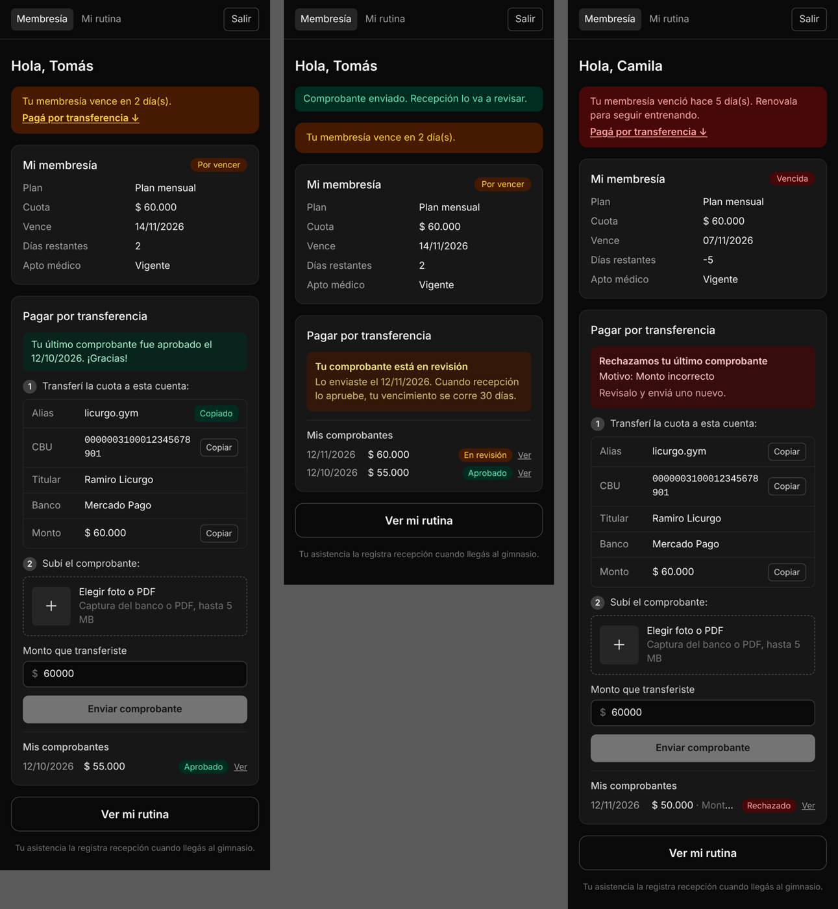
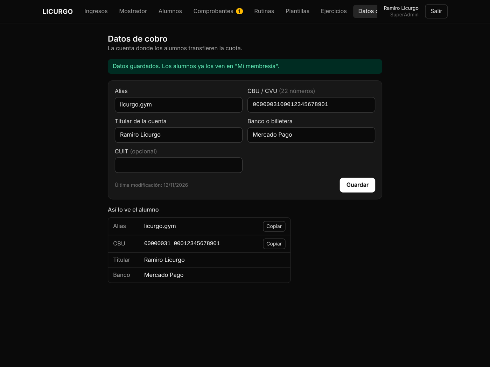
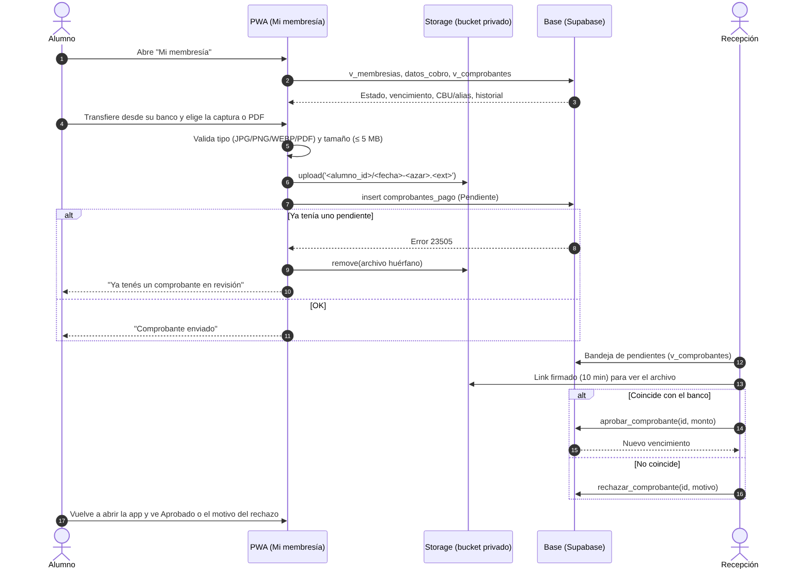
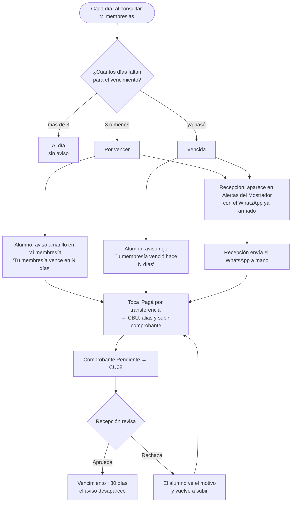

# B4 · Mi membresía y comprobante

**Pareja B** · CU07 · RF02 · RNF02

## Ramas

```
dev
 └── feature/b4-b5-comprobantes          (integración)
      ├── feature/b4-membresia-comprobante   → PR a la integración
      └── feature/b5-validar-comprobantes    → PR a la integración (sale de B4)
```

## Funcionalidades

| Rol | Pantalla | Qué hace |
|-----|----------|----------|
| Alumno | `/alumno` · **Mi membresía** | Estado de la cuota, vencimiento y días restantes. Aviso 3 días antes y cuando venció, con acceso a "Pagá por transferencia" |
| Alumno | `/alumno` · **Pagar por transferencia** | Alias, CBU, titular y monto con botón **Copiar**. Subir foto o PDF del comprobante y el monto transferido |
| Alumno | `/alumno` · **Mis comprobantes** | Historial: En revisión, Aprobado o Rechazado con el motivo. **Ver** abre el archivo |
| SuperAdmin | `/admin/datos-cobro` · **Datos de cobro** | Carga y cambia alias, CBU/CVU, titular, banco y CUIT. Muestra cómo lo ve el alumno |





## CU07 · Subir comprobante de transferencia

- **Actor:** Alumno.
- **Precondición:** sesión iniciada en la PWA.
- **Flujo principal:**
  1. El alumno entra a *Mi membresía*.
  2. Ve el estado de su cuota y, en *Pagar por transferencia*, el alias, el CBU y el monto de la cuota vigente.
  3. Copia el alias o el CBU y transfiere desde la app de su banco.
  4. Toca *Elegir foto o PDF* y selecciona la captura o el PDF; ve una miniatura.
  5. Confirma el monto transferido (viene cargado con el valor de la cuota) y toca *Enviar comprobante*.
  6. El sistema guarda el archivo en el bucket privado y registra el comprobante en estado **Pendiente**.
  7. El alumno ve *"Tu comprobante está en revisión"*.
- **Flujos alternativos:**
  - **A · Archivo inválido:** otro formato o más de 5 MB → el sistema indica el problema y no lo envía.
  - **B · Ya hay uno en revisión:** no se muestra el formulario hasta que recepción lo revise (y la base lo impide aunque se intente).
  - **C · Comprobante rechazado:** el alumno ve *"Rechazamos tu último comprobante"* con el motivo y vuelve al paso 3.
  - **D · Datos de la cuenta sin cargar:** se muestra "Pedíselos a recepción".
- **Postcondición:** comprobante Pendiente en la bandeja de recepción (CU08).



## Flujo de aviso de vencimiento

El estado sale de `v_membresias` cada vez que se consulta (no hace falta ningún proceso nocturno):

| Días hasta el vencimiento | Estado | Alumno | Recepción |
|---|---|---|---|
| más de 3 | Al día | — | — |
| 3 o menos | Por vencer | Aviso amarillo + "Pagá por transferencia" | Alertas del Mostrador con WhatsApp armado |
| ya pasó | Vencida | Aviso rojo + "Pagá por transferencia" | Ídem |

Cuando recepción aprueba la transferencia, el vencimiento se corre 30 días y el aviso desaparece solo.



## Reglas

- **RNF02 · Almacenamiento seguro:** bucket `comprobantes` privado (imagen o PDF, hasta 5 MB). Cada alumno sube solo a su carpeta (`<alumno_id>/…`) y ve solo sus archivos; recepción y SuperAdmin ven todos. Se accede con links firmados que vencen.
- El archivo se renombra (`<fecha-hora>-<azar>.<ext>`): no se guarda el nombre original.
- **Un solo comprobante pendiente por alumno** (índice único parcial).
- Si se sube el archivo pero falla el alta, el front lo borra. La política solo permite borrar archivos propios **que no estén registrados**: un comprobante enviado es evidencia y nadie lo borra.
- `datos_cobro`: una sola fila; la leen todos los usuarios logueados y la cambia solo el SuperAdmin (se guarda quién y cuándo). Arranca vacía: el dueño tiene que cargar los datos reales.

## Base de datos

Migración `supabase/migrations/20261112_01_b4_b5_comprobantes.sql` (también en `schema.sql`, sección 19.13). Requiere las de Pareja A (A2).

| Objeto | Para qué |
|---|---|
| `datos_cobro` | CBU, alias, titular, banco, CUIT |
| `uq_comprobante_pendiente_por_alumno` | Un pendiente por alumno |
| política `comprobantes_insert` | El archivo tiene que estar en la carpeta del alumno |
| política Storage `comprobantes_delete_huerfano` | Borrar solo archivos propios no registrados |
| vista `v_comprobantes` | Historial del alumno y bandeja de recepción (respeta el RLS) |

## Pruebas

- **Base (Postgres local con A2–A5 aplicadas):** el alumno ve los datos de cobro y no los puede editar, tampoco recepción; el dueño sí. Un pendiente por alumno. No puede registrar un archivo de otra carpeta. Borra un huérfano propio, pero no uno registrado. La migración corre dos veces sin error.
- **Unitarias** (`lib/comprobantes.js`): validación de archivo, ruta, vista previa del vencimiento (misma regla que A2), estado de la tarjeta, montos (`26.000`, `$ 26.000`, `26000,50`), CBU/alias/CUIT.
- **Navegador:** flujo completo alumno → recepción → alumno en celular y escritorio.
