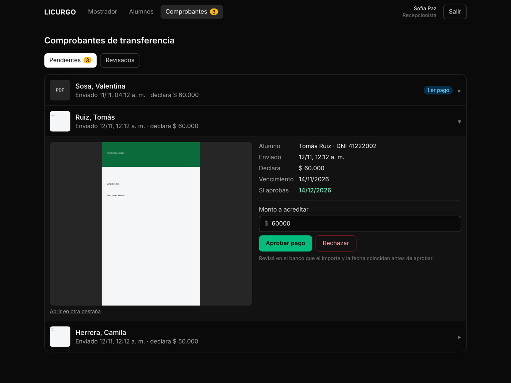
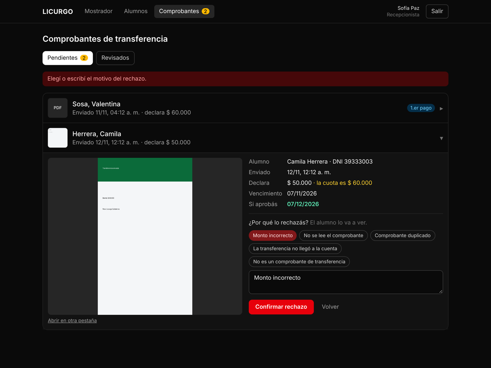
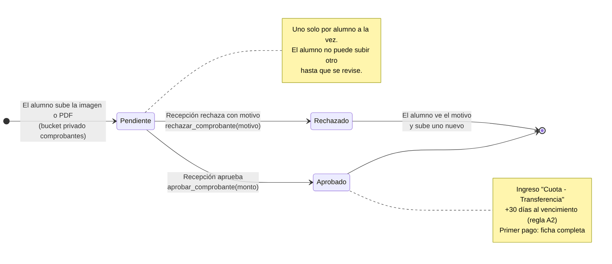
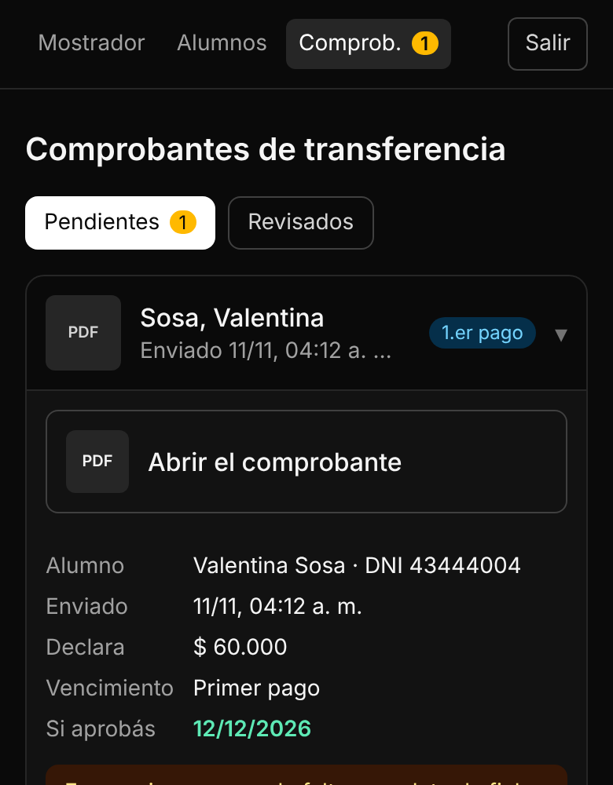

# B5 · Validar comprobantes

**Pareja B** · CU08 · RF03 · Depende de B4 y de la regla de vencimiento de Pareja A (A2, `_extender_membresia`).

## Funcionalidades

| Rol | Pantalla | Qué hace |
|-----|----------|----------|
| Recepción / SuperAdmin | Menú **Comprobantes** | Contador amarillo con los pendientes |
| Recepción / SuperAdmin | `/recepcion/comprobantes` · **Pendientes** | Del más viejo al más nuevo, con miniatura, monto declarado y etiqueta *1.er pago* |
| Recepción / SuperAdmin | Detalle | Imagen grande o PDF, monto declarado vs. cuota, vencimiento actual y **el que queda si aprobás** |
| Recepción / SuperAdmin | **Aprobar pago** | Monto a acreditar (por defecto, la cuota) |
| Recepción / SuperAdmin | **Rechazar** | Motivos rápidos o escritos; el alumno los ve. Después, botón *Avisarle por WhatsApp* |
| Recepción / SuperAdmin | **Revisados** | Últimos 30 con quién lo revisó, cuándo y el monto o el motivo |

## CU08 · Validar comprobantes de pago

- **Actores:** Recepcionista, SuperAdmin.
- **Precondición:** hay comprobantes en estado Pendiente.
- **Flujo principal:**
  1. El operador entra a *Comprobantes* (el menú muestra cuántos hay).
  2. El sistema lista los pendientes con alumno, fecha, monto declarado y miniatura.
  3. Toca uno: ve el comprobante grande, el monto declarado, la cuota, el vencimiento actual y el nuevo.
  4. Coteja importe y fecha con la cuenta del banco.
  5. Confirma el monto a acreditar y toca **Aprobar pago**.
  6. El sistema, en una sola transacción:
     - marca el comprobante **Aprobado** con quién y cuándo;
     - registra el ingreso *Cuota - Transferencia* (sin turno de caja: no entra en el arqueo);
     - suma 30 días al vencimiento con la regla de A2.
  7. Muestra el nuevo vencimiento.
- **Flujo alternativo A · Rechazo:** en el paso 5 toca **Rechazar**, elige o escribe el motivo y confirma. El comprobante queda **Rechazado**; el alumno ve el motivo en *Mi membresía* y puede subir otro.
- **Flujo alternativo B · Primer pago con ficha incompleta:** el sistema avisa qué datos faltan y deshabilita *Aprobar*. *Completar ficha* abre la edición del alumno; al volver, se aprueba.
- **Flujo alternativo C · Monto distinto a la cuota:** se resalta "la cuota es $…"; el operador decide el monto a acreditar.
- **Excepciones:** comprobante ya revisado por otra persona; monto ≤ 0; motivo vacío.
- **Postcondición:** el alumno queda al día con su nuevo vencimiento y la transacción queda auditada con el usuario que la aprobó.

## Estados del comprobante

| Estado | Quién lo pone | Qué ve el alumno |
|---|---|---|
| Pendiente | El alumno al subirlo | "En revisión"; no puede subir otro |
| Aprobado | Recepción / SuperAdmin (`aprobar_comprobante`) | "Aprobado" y el nuevo vencimiento |
| Rechazado | Recepción / SuperAdmin (`rechazar_comprobante`, motivo obligatorio) | "Rechazado" + motivo; puede subir uno nuevo |

Aprobado y Rechazado son finales: nadie puede cambiar el estado a mano (sin permisos de UPDATE/DELETE sobre la tabla).

## Reglas

- Solo Recepción y SuperAdmin aprueban o rechazan (`_exigir_rol` en la función). El coach no ve los comprobantes.
- Recepción **no** ve los totales de ingresos (RNF01): aprueba, pero el dashboard es del dueño.
- El archivo se ve con links firmados de 10 minutos. En el celular el PDF se abre aparte (los navegadores móviles no lo muestran incrustado).

## Pruebas

- **Base (local):** aprobar con monto 0 → `MONTO_INVALIDO`; aprobar dos veces → `COMPROBANTE_YA_REVISADO`. Camila (vencida hace 5 días) → +30 desde su vencimiento. Rechazo sin motivo → `MOTIVO_REQUERIDO`. Tomás ve su motivo y solo sus comprobantes. Valentina (1.er pago, ficha incompleta) → `FICHA_INCOMPLETA` y el comprobante sigue Pendiente. El coach no ve ni aprueba.
- **Navegador:** aprobación con nuevo vencimiento, ficha incompleta con *Aprobar* deshabilitado y link a la ficha, rechazo con motivo rápido, contador del menú que baja al revisar, pestaña Revisados y vista en el celular.
