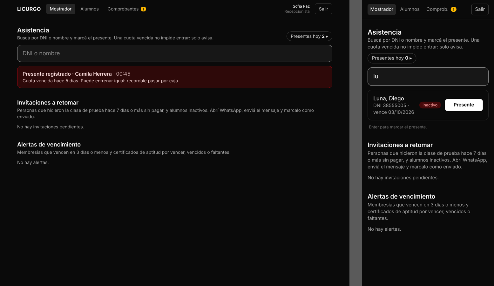

# B6 · Check-in en recepción

**Pareja B** · CU03 · RF11 · rama `feature/b6-checkin-recepcion` → `dev`

Base: PR #1 (registrar_checkin solo para Recepción y SuperAdmin). Este módulo pule la pantalla.

## Funcionalidades (`/recepcion` · Mostrador → Asistencia)

| Qué | Cómo |
|---|---|
| Buscador | DNI con o sin puntos (desde 3 números, también parte del DNI) o nombre/apellido sin importar tildes ni el orden ("ruiz tomas"). Primero el DNI exacto. El cursor queda en el buscador al entrar y después de cada presente |
| Marcar presente | Botón **Presente** en cada resultado; **Enter** marca si hay uno solo |
| Ya vino hoy | En lugar del botón muestra **✓ Presente 18:42** |
| Resultado | Tarjeta con el nombre, la hora y la situación de la cuota, en color: verde (al día / pase libre), amarillo (por vencer), rojo (vencida o inactivo), celeste (clase de prueba) |
| Presentes hoy | Contador y lista con la hora de llegada |

## CU03 · Registrar asistencia presencial (versión de recepción, sin bloqueo)

> Reemplaza al CU03 original: la asistencia **no** la marca el alumno y una cuota vencida **no** impide entrar.

- **Actores:** Recepcionista, SuperAdmin.
- **Propósito:** registrar que el alumno vino a entrenar hoy y avisar en el momento si debe la cuota.
- **Precondición:** sesión de Recepcionista o SuperAdmin; el alumno está registrado y no fue dado de baja.
- **Flujo principal:**
  1. El alumno llega al gimnasio.
  2. El recepcionista escribe el DNI o el nombre en *Asistencia*.
  3. El sistema muestra las coincidencias con el estado de la cuota (Al día, Por vencer, Vencida, Inactivo, Clase de prueba o Pase libre).
  4. El recepcionista toca **Presente** (o Enter).
  5. El sistema registra la asistencia con fecha y hora y muestra la confirmación con la situación de la cuota.
- **Flujos alternativos:**
  - **A · Cuota vencida o inactivo:** se registra igual; el sistema avisa en rojo *"Cuota vencida hace N días. Puede entrenar igual: recordale pasar por caja."*
  - **B · Pase Libre (RF12):** se muestra como al día y no hay aviso de cuota.
  - **C · Ya tenía el presente de hoy:** el resultado muestra la hora en lugar del botón; si igual se intenta, no se duplica (una asistencia por alumno por día).
  - **D · No aparece:** el sistema lo indica; si es nuevo se da de alta en *Alumnos* (CU01).
- **Reglas:**
  - **RN1:** el presente lo marca solo recepción (o el dueño). El alumno no puede marcarse.
  - **RN2:** la cuota vencida avisa pero no bloquea.
  - **RN3:** una asistencia por alumno y por día (`uq_asistencia_diaria`).
  - **RN4:** el día se toma en hora de Argentina (`hoy_ar()`).
- **Postcondición:** la asistencia queda registrada y alimenta las métricas de concurrencia (CU13, B7).

## Pase Libre

La marca la agrega Pareja A en A6 (RF12). Mientras la columna no exista, el front la lee como **falso** (`pase_libre ?? false`), así que no depende de A6 para funcionar. Cuando A6 la sume a `v_membresias`, el check-in la muestra sola.

## Pruebas

- **Unitarias** (`lib/checkin.js`): DNI con puntos, parcial y demasiado corto; nombres con y sin tilde, en cualquier orden; situación para al día, por vencer (hoy / N días), vencida, inactivo, clase de prueba y pase libre (gana sobre vencida); sin columna de pase libre → falso.
- **Navegador:** foco al abrir, Enter con un resultado, aviso rojo con vencida sin bloquear, inactivo, pase libre, presente repetido muestra la hora, sin resultados, lista de presentes, vista en el celular.
