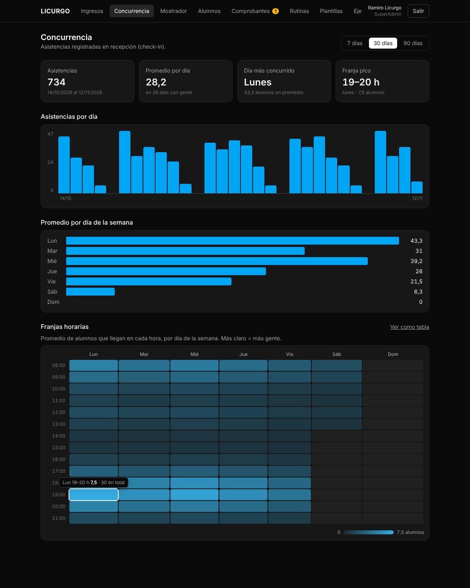
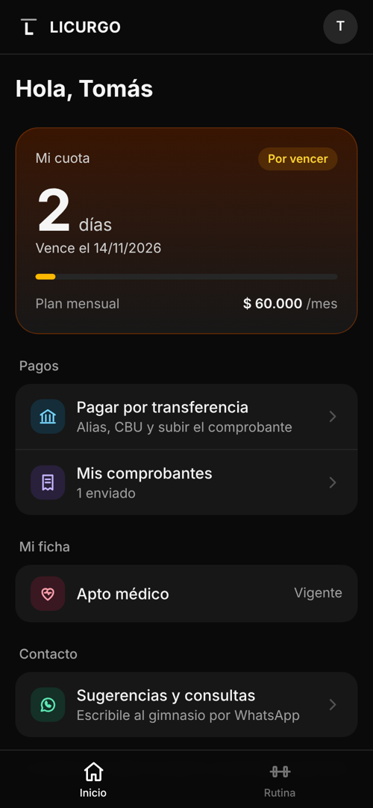

# B7 · Métricas de concurrencia y botón de contacto

**Pareja B** · CU13 · RF13 · rama `feature/b7-metricas-contacto` → `dev`
Consume las asistencias que registra recepción (B6).

## Funcionalidades

| Rol | Pantalla | Qué hace |
|-----|----------|----------|
| SuperAdmin | `/admin/concurrencia` · **Concurrencia** | Período de 7, 30 o 90 días. Resumen (asistencias, promedio por día con gente, día más concurrido, franja pico), barras por día, promedio por día de la semana y **mapa de franjas horarias** 8–22 h. Se puede ver como tabla |
| SuperAdmin | `/admin/datos-cobro` | Campo **WhatsApp para sugerencias y consultas** (si queda vacío se usa su celular) |
| Alumno | Inicio · **Sugerencias y consultas** | Abre WhatsApp con un mensaje armado hacia el número del gimnasio |

## CU13 · Analizar métricas de concurrencia

- **Actor:** SuperAdmin.
- **Propósito:** conocer los días y horarios con más gente para organizar profesores y equipamiento.
- **Precondición:** sesión de SuperAdmin; hay asistencias registradas por recepción (CU03).
- **Flujo principal:**
  1. El dueño entra a *Concurrencia*.
  2. Elige el período: 7, 30 (por defecto) o 90 días.
  3. El sistema procesa las asistencias del período y muestra:
     - asistencias totales y **promedio por día** (sobre los días en que vino alguien, así los días cerrados no bajan el promedio);
     - el **día de la semana más concurrido** y la **franja pico**;
     - asistencias de cada día (barras, con el valor al pasar el mouse);
     - promedio por día de la semana;
     - **mapa de calor** de franjas horarias de 8:00 a 22:00 × día de la semana: cada celda es el promedio de alumnos que llegan en esa hora ese día (asistencias ÷ cantidad de ese día de la semana en el período).
- **Flujo alternativo A · Ver como tabla:** el mapa se muestra como tabla con los números (accesibilidad / para copiar).
- **Flujo alternativo B · Sin asistencias:** los indicadores quedan en 0 y el mapa vacío.
- **Reglas:**
  - **RN1:** solo el SuperAdmin (la función `metricas_concurrencia` exige el rol en el servidor).
  - **RN2:** la hora es la de llegada (check-in) en hora de Argentina. Llegadas fuera de 8–22 h se suman a la primera o última franja.
  - **RN3:** período máximo de un año.
- **Postcondición:** el dueño identifica los picos de saturación de la sala.

## CU · Contactar al gimnasio por WhatsApp (RF13)

- **Actor:** Alumno.
- **Propósito:** mandar una sugerencia o consulta al dueño sin un módulo de mensajería interno.
- **Precondición:** sesión de alumno en la PWA; el gimnasio tiene un WhatsApp de contacto (el que cargó el dueño en *Datos de cobro* o, si no, el celular del SuperAdmin).
- **Flujo principal:**
  1. En *Inicio*, el alumno toca **Sugerencias y consultas**.
  2. El sistema abre WhatsApp (app o web, en una pestaña aparte y por HTTPS) con el chat del gimnasio y el mensaje: *"Hola, soy {nombre} {apellido}, alumno de Licurgo Calistenia. Les escribo por una sugerencia / consulta: "*.
  3. El alumno completa el mensaje y lo envía desde WhatsApp.
- **Flujo alternativo · Sin número:** si no hay WhatsApp cargado ni celular del SuperAdmin, la opción no aparece.
- **Reglas:**
  - **RN1 (RNF05):** el enlace es `https://wa.me/549…` y se abre en una pestaña nueva.
  - **RN2:** el alumno no puede leer los datos del SuperAdmin; la función `whatsapp_contacto()` le devuelve solo el número.
  - **RN3:** el sistema no guarda los mensajes: la conversación queda en WhatsApp.
- **Postcondición:** el mensaje queda en el WhatsApp del gimnasio.

## Base de datos

Migración `supabase/migrations/20261112_02_b7_metricas_contacto.sql` (sección 19.14 de `schema.sql`).

| Objeto | Para qué |
|---|---|
| `metricas_concurrencia(desde, hasta)` | JSON con total, días con asistencia, serie diaria, promedio por día de la semana y franjas (solo SuperAdmin) |
| `datos_cobro.whatsapp` | WhatsApp de contacto (10 números, sin 0 ni 15) |
| `whatsapp_contacto()` | Número de contacto para el alumno |

`v_concurrencia` (vista histórica sin período) sigue disponible; la pantalla usa la función porque necesita filtrar por fechas y calcular promedios.

## Pruebas

- **Base (local):** promedio por franja = total ÷ cantidad de ese día de la semana (4 lunes en 30 días); domingo sin asistencias = 0; rango inválido → `RANGO_INVALIDO`; recepción y alumno → `PERMISO_DENEGADO`; contacto cae al celular del SuperAdmin y toma el WhatsApp cuando el dueño lo carga; formato inválido rechazado; anónimo sin acceso.
- **Unitarias** (`lib/metricas.js`): fechas del período, matriz 8–22 h con llegadas fuera de horario, máximo, resumen con y sin datos, textos.
- **Navegador:** resumen, tooltip del mapa y de las barras, cambio de período, vista de tabla, botón de contacto con el mensaje armado y el número pegado con guiones (se limpia solo).
