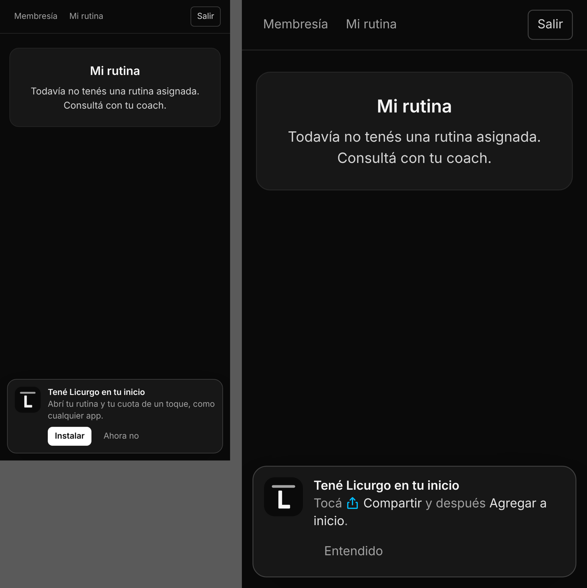

# PWA · Manifest e instalación (RNF03)

**Pareja B** · rama `feature/b1-pwa` → `dev`

> RNF03 – La interfaz del alumno debe responder bajo estándares de Progressive Web App (PWA),
> permitiendo una carga instantánea y fluida desde navegadores móviles (iOS/Android).

## Qué se agregó

| Archivo | Para qué |
|---|---|
| `public/manifest.webmanifest` | Nombre ("Licurgo Calistenia" / "Licurgo"), íconos, colores, `display: standalone`, orientación vertical y accesos directos a *Mi rutina* y *Mi membresía* (mantener apretado el ícono en Android). |
| `public/icons/*` | Ícono 192 y 512, versión *maskable* (Android recorta a círculo/gota), `apple-touch-icon` 180 para iPhone y favicon. |
| `public/sw.js` | Service worker: la app abre al instante desde el ícono y sin señal muestra la última versión cargada. |
| `src/lib/pwa.js` | Registra el service worker (solo en producción) y maneja el evento de instalación. |
| `src/components/InstalarApp.jsx` | Aviso abajo de la pantalla para instalar la app. |
| `index.html` | Enlaces al manifest, íconos y metas de iOS. |
| `vercel.json` | `sw.js` y manifest sin caché del navegador (así toma los cambios); `/assets/*` con caché larga (tienen hash). |

## Estrategia de caché del service worker

- **Pantallas (navegación):** primero la red → siempre llega la última versión publicada. Sin red, la copia guardada.
- **`/assets/*`** (JS/CSS de Vite con hash): primero la caché. Cada deploy trae nombres nuevos; se guardan hasta 60 y se descartan los viejos.
- **Íconos y manifest:** caché, actualizándose en segundo plano.
- **Supabase y otros dominios: no se tocan.** Los datos (cuotas, rutinas, observaciones) van siempre en vivo y el service worker no guarda datos de alumnos.
- Para limpiar todas las cachés de los usuarios: cambiar `VERSION` en `public/sw.js`.

## Instalación

- **Android / Chrome / Edge (y escritorio):** aparece *"Tené Licurgo en tu inicio"* con el botón **Instalar**, que abre el diálogo del navegador.
- **iPhone / iPad:** Safari no tiene botón de instalación; el aviso explica *Compartir → Agregar a inicio*.
- No aparece si la app ya está abierta desde el ícono, ni durante 14 días después de *Ahora no* / *Entendido*.

## Pruebas

- Unitarias de `src/lib/pwa.js`: cuándo mostrar el aviso, detección de iPhone/iPad, modo app, descarte de 14 días, evento de instalación (aceptar, uso único, `appinstalled`).
- Navegador (Chromium, sitio armado como en producción):
  - `Page.getAppManifest` y `Page.getInstallabilityErrors` → **sin errores** (instalable).
  - El service worker toma control y guarda `/`, assets, íconos y manifest.
  - **Sin conexión**, recargar abre la app igual.
  - Android: el botón Instalar llama al diálogo nativo y el aviso desaparece.
  - iPhone: muestra las instrucciones; *Entendido* lo oculta y no vuelve a insistir al recargar.

## Cómo probarlo en el celular

1. Entrar a https://licurgo-calistenia.vercel.app desde Chrome (Android) o Safari (iPhone) e iniciar sesión.
2. Android: tocar **Instalar** en el aviso (o menú ⋮ → *Instalar app*). iPhone: Compartir → *Agregar a inicio*.
3. Abrir desde el ícono: se abre a pantalla completa, sin barra del navegador.

## Actualización automática

**Problema:** en el iPhone la app instalada no se recarga al volver a abrirla; queda suspendida con el código viejo y no se entera de los deploys (había que borrarla y reinstalarla).

**Solución:**

| Pieza | Qué hace |
|---|---|
| `vite.config.js` | Cada compilación lleva su versión (`__APP_VERSION__` = commit de Vercel) y publica `/version.json` |
| `src/lib/actualizacion.js` | Compara la versión del código con `/version.json` al abrir, al volver a la app, al recuperar conexión y cada 5 minutos |
| `src/components/ActualizacionApp.jsx` | Si hay versión nueva: recarga sola en pantallas sin formularios; si se está cargando algo, muestra *"Hay una versión nueva · Actualizar"* |
| `public/sw.js` (v2) | Las pantallas se piden siempre al servidor (`no-cache`) |
| `vercel.json` | Todo menos `/assets` sin caché del navegador; `version.json` sin guardar nunca |

- **Recarga sola en:** `/alumno`, `/alumno/rutina`, `/coach`, `/recepcion`, `/admin`. El checklist vive en localStorage, así que no se pierde.
- **Pregunta antes en:** editor de rutinas, plantillas, ejercicios, observaciones, alumnos, comprobantes, datos de cobro, login. También en `/alumno` si ya se eligió el archivo del comprobante o hay algo escrito con el cursor.
- Si la persona pasa de una pantalla con formulario a una segura, se actualiza en ese momento.
- Una sola recarga automática por versión (evita bucles si el CDN tarda en propagar).

**Pruebas (Chromium emulando iPhone, con service worker y "deploys" simulados):** sin cambios no recarga; con deploy nuevo, al volver a la app se actualiza sola; no entra en bucle; con un archivo elegido muestra el aviso y *Actualizar* carga la versión nueva; en *Datos de cobro* con texto escrito muestra el aviso sin perder lo escrito; sin conexión no falla; abrir en frío trae la última versión.

> Los teléfonos que tienen instalada una versión anterior a esta necesitan cerrarla del todo una vez (deslizar hacia arriba en el selector de apps) y abrirla de nuevo. Desde ahí se actualiza sola.
