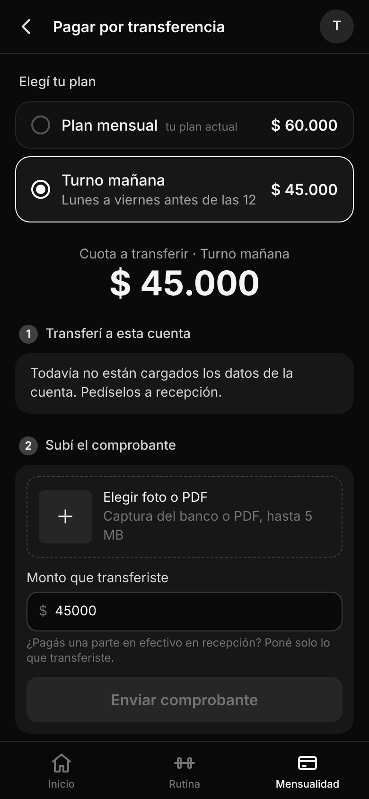
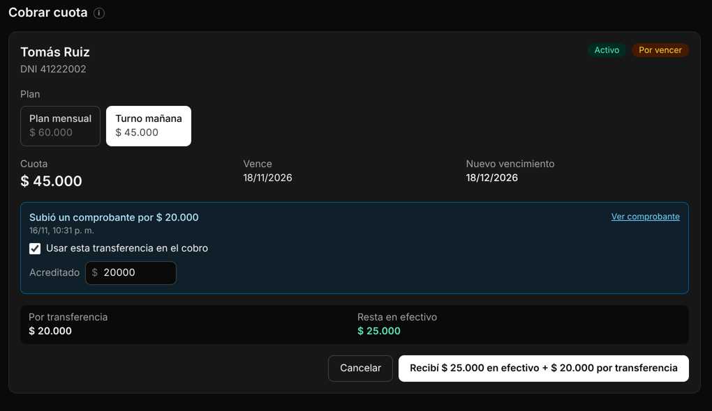

# Planes de cuota y pago mixto (16/11)

**Pareja B** · Migración `supabase/migrations/20261116_01_planes_pago_mixto.sql` (sección 19.28 de `schema.sql`).

## Planes de cuota (SuperAdmin → Planes de cuota · `/admin/planes`)

- El dueño arma las cuotas que ofrece, como en Productos: nombre, precio por mes, días por semana (opcional) y una descripción corta que ve el alumno (ej. *Turno mañana · $45.000 · Lunes a viernes antes de las 12*).
- Lápiz para editar; basurero para **dar de baja** (no se borra: hay alumnos y pagos con ese plan). Tiene que quedar al menos uno a la venta. Se muestra cuántos alumnos activos tiene cada plan.
- Un cambio de precio vale para los pagos siguientes.

## El alumno elige el plan (Mensualidad → Pagar por transferencia)

- Si hay más de un plan, elige uno (arranca en el suyo). La cuota y el monto sugerido cambian con el plan.
- El comprobante guarda el plan elegido (`comprobantes_pago.plan_id`). Al aprobarse, el alumno queda en ese plan.
- Si paga una parte en efectivo en recepción, pone solo lo que transfirió.

## Pago mixto en Caja (Cobrar cuota)

- Se elige el plan y aparece la **transferencia que informó el alumno** (monto, cuándo, a qué cuenta, botón para ver el comprobante). Lo que falta se cobra **en efectivo**: *Recibí $25.000 en efectivo + $20.000 por transferencia*.
- En la búsqueda, los alumnos con un comprobante sin revisar muestran *Transfirió $X*.
- Una sola operación (`cobrar_cuota`): aprueba el comprobante, registra la transferencia y el efectivo (este último en el turno de caja) y suma 30 días.
- **Sin comprobante** (16/11, migración `20261116_02`): recepción y dueño eligen **Efectivo, Transferencia o Mixto** y escriben cuánto transfirió. La recepcionista tiene que tildar *Vi la transferencia en el celular del alumno*; el ingreso queda con el detalle *(sin comprobante, verificada por recepción)* para que el dueño lo identifique en Ingresos. Esto reemplaza la regla anterior de A2 (recepción solo anotaba transferencias con comprobante).
- En **Comprobantes**, si el alumno transfirió menos que la cuota se avisa cuánto falta y se manda a Caja; el monto a acreditar arranca en lo que informó el alumno.
- Se sacó la barra de scroll que aparecía debajo de las pestañas de Caja en Windows.

## Reglas en la base

- `cobrar_cuota(alumno, plan, efectivo, transferencia, comprobante)`: el plan tiene que estar activo y efectivo + transferencia = precio del plan. El efectivo de la recepcionista exige turno abierto.
- `ingresos` admite un registro por comprobante: queda en la parte por transferencia.
